# Bahi TV

Bahi TV is a remote-first hotel TV interface built with Preact and TypeScript. Guests navigate services using directional controls, with focus restored when they return, English and Arabic layouts, and connected flows from selection through confirmation.

The project began with the brief: implement the Figma homepage and navigation. Additional guest-service screens extend that foundation to show how the same navigation, state and visual rules work across a larger interface.

|                    |                                                                                               |
| ------------------ | --------------------------------------------------------------------------------------------- |
| **Live prototype** | https://hansajaweerarathna.github.io/bahi-tv-preact/                                          |
| **With demo keys** | https://hansajaweerarathna.github.io/bahi-tv-preact/?demo                                     |
| **Design**         | [Figma file](https://www.figma.com/design/gV7jxln7zVVz6DtArLNM81/Bahi-TV-Screens?node-id=0-1) |


Try it with arrow keys, Enter and Escape.

Interactive frontend prototype; hotel data and service actions are simulated.

## The home page


A two-minute walkthrough:

1. Press the arrow keys to move across the tiles. Focus stops at the edges.
2. Press Up from a tile to reach the header, then Down to return to the same tile.
3. Press Enter on a tile, then Escape. Focus comes back to the tile you opened.
4. Press Escape on Home. It shows a hint instead of leaving the app.
5. With the demo link, press P for the promotional layout and N for a new message.

## Controls

| Keyboard            | TV remote | Action                        |
| ------------------- | --------- | ----------------------------- |
| Arrow keys          | D-pad     | Move focus                    |
| Enter               | OK        | Select                        |
| Escape or Backspace | Back      | Go back                       |
| H or Home           | Home      | Home screen                   |
| M                   | Menu      | Settings                      |
| + and -             | Volume    | Change the volume             |
| 0 to 9              | Numbers   | Tune a channel on the TV page |

<details>
<summary><strong>Demo controls</strong></summary>

The demo link adds keys for showing each state: **P** promotional offers, **N** a new message, **C** check-out day, **S** a list of eleven screen states, **D** the key legend.

</details>

## Design translation

The Figma file defines the main screens, their composition and their visual language. The code carries that across as a small set of reusable rules.

| In the design                        | In the code                                                                                                                      |
| ------------------------------------ | -------------------------------------------------------------------------------------------------------------------------------- |
| 1920×1080 frames                     | A fixed canvas with one uniform scale transform ([`TvCanvas`](src/app/TvCanvas.tsx))                                             |
| Safe margins                         | 96px and 54px padding, 5% of each edge, on every screen layout                                                                   |
| Two levels of service tile           | 188px primary and 88px compact rows, driven by one list ([`tiles.ts`](src/widgets/service-tiles/tiles.ts))                       |
| Serif greeting, sans-serif interface | A type scale of 64, 48, 36, 28 and 24px as tokens ([`theme.css`](src/app/styles/theme.css))                                      |
| Warm dark palette with a gold accent | Colour tokens, so high contrast overrides values rather than adding styles                                                       |
| Focus state                          | A raised surface, 4px gold ring and a small scale, from one `tv-focus` utility ([`utilities.css`](src/app/styles/utilities.css)) |
| Text over photography                | A vertical scrim gradient that keeps the greeting and tiles readable                                                             |

A static frame can't specify behaviour, so these were worked out in code:

- Where focus goes from each item, and where it returns after Back or Home
- When a notice appears, and which notice takes priority
- Greetings by hotel time, and fallbacks for missing or long guest names
- Arabic mirroring with logical CSS properties
- High contrast and larger text, including labels that need to wrap
- Missing weather, and the screen shown between guests

## Three representative flows

### Home navigation

Shown at the top of this page.

**What it demonstrates:** the core of the brief. Focus moves between tile rows and the header without a hand-written route between them, and returning from a service restores the item the guest opened.

### Arabic and right-to-left

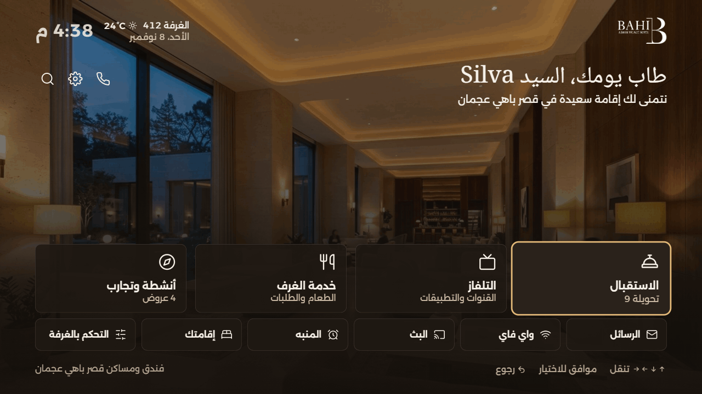

**What it demonstrates:** the layout mirrors from one language setting. Left moves to the item that is physically on the left, so grid navigation needs no key swap. The offer carousel is the deliberate exception, where Left means "next" in Arabic because its order is reversed.

### Ordering food


**What it demonstrates:** multi-step state beyond a single screen. The quantity carries into the basket, the basket into the review, and confirmation clears it and adds a message. The confirmation is simulated.

## Promotional layout

When the hotel has offers to promote, they take over the background. The carousel advances on its own and pauses while the guest is on it.

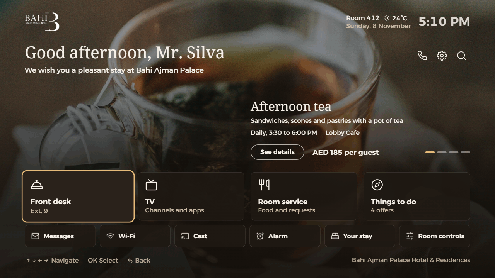

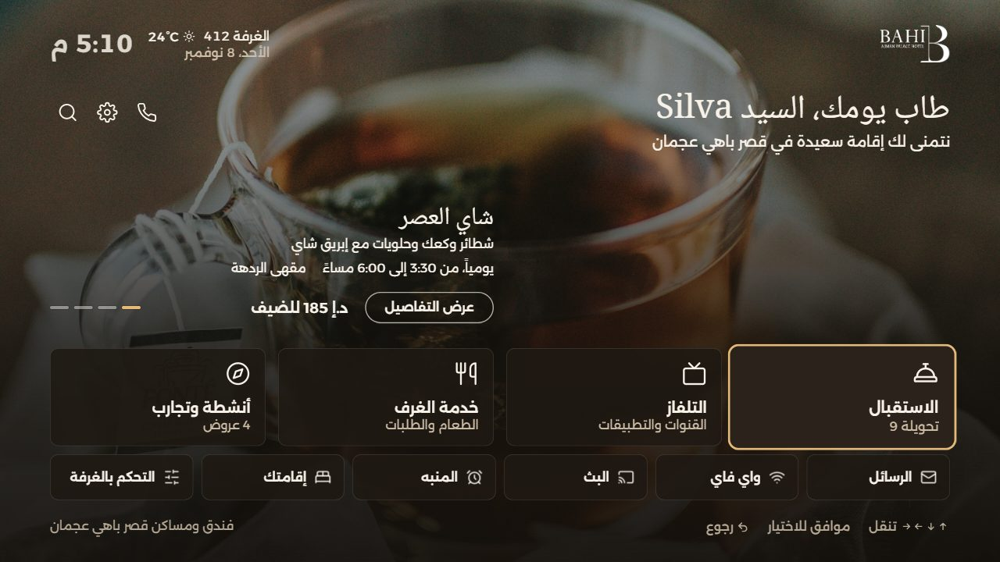

## Engineering decisions

### Focus follows screen geometry

- **Problem:** a neighbour map for every item is slow to maintain and has to be reversed for Arabic.
- **Decision:** directional movement uses each element's real position, with group memory and focus recovery ([`focus-registry.ts`](src/shared/remote-navigation/model/focus-registry.ts), [`find-next-focus.ts`](src/shared/remote-navigation/lib/find-next-focus.ts)). Screens register focusable controls without maintaining a fixed neighbour map.
- **Trade-off:** each move reads element positions, and some screens still need explicit handling, such as room service tabs and alarm fields.

### Focus recovery handles disappearing elements

- **Problem:** a notice can disappear while it holds focus, which would leave the remote with nothing to act on.
- **Decision:** focus moves to the last content item, or to the first item still on screen.
- **Trade-off:** when the last item has also gone, the fallback is the first registered item, which may not be the closest one.

### Secondary screens load on demand

- **Problem:** a TV should show the home screen as soon as possible.
- **Decision:** Home loads eagerly, and other screens use lazy imports ([`App.tsx`](src/app/App.tsx)). The QR library loads only when a code is shown.
- **Trade-off:** the first visit to a screen waits for its file to download.

### Document preferences live in one place

- **Problem:** language, direction, contrast and text size each affect the whole interface.
- **Decision:** one effect writes them to the document root ([`useDocumentPreferences.ts`](src/app/useDocumentPreferences.ts)), and CSS tokens respond to those attributes.
- **Trade-off:** preferences apply to the whole document, so one region can't differ from the rest.

### Time comes from the hotel's time zone

- **Problem:** the greeting and clock must match the hotel, even when the browser is set to a different time zone.
- **Decision:** the time is converted to Asia/Dubai from one setting.
- **Trade-off:** it still depends on the device's clock being correct.

### One canvas, scaled uniformly

- **Problem:** the design is drawn at 1920×1080, and TVs and browser windows vary.
- **Decision:** one transform preserves the design's proportions.
- **Trade-off:** other aspect ratios are letterboxed, and real TV rendering still needs checking.

### State stays in memory

- **Problem:** the prototype has no hotel backend to store guest data.
- **Decision:** signals hold state in memory, and nothing is written to browser storage.
- **Trade-off:** a reload resets everything. Persistence belongs with a real hotel integration.

## Scope

|               |                                                                                                                    |
| ------------- | ------------------------------------------------------------------------------------------------------------------ |
| **The brief** | The home page, matching the Figma design, and its remote navigation                                                |
| **Extended**  | Room service, requests, alarms, search, TV, offers, room controls, settings, Arabic, high contrast and larger text |
| **Simulated** | Guest details, messages, weather, orders, requests, alerts and room controls. Actions update local state only      |

## TV-oriented interaction design

- **Preact Signals** update only what reads a value. Each minute the clock changes its own text directly, and only the greeting and notice re-render.
- **Repeated arrow events are throttled to reduce excessive focus movement.** Focus moves at most once every 120 ms.
- **Tiles don't animate their focus ring.** Moving focus only transitions transform and colours, because animating `box-shadow` is expensive.
- **Home screen text is 24px or larger**, for reading from a distance.

## Verification

| Evidence                      | Result                 |
| ----------------------------- | ---------------------- |
| Unit tests                    | 75 passing             |
| JavaScript at start-up        | 35.43 KB gzipped       |
| CSS at start-up               | 7.16 KB gzipped        |
| Focus move at 6× CPU slowdown | 35 ms median           |
| Random remote key presses     | 2600 presses, 0 errors |

Environment, commands and method are in [docs/measurements.md](docs/measurements.md). A slowed desktop browser isn't a physical TV, so these are comparison figures only.

The tests cover specific behaviour:

- [Home navigation](src/shared/remote-navigation/lib/find-next-focus.test.ts): edges without wrapping, moves between tile rows, the notice and the header, and skipping a switched-off tile
- [Focus recovery](src/shared/remote-navigation/model/focus-registry.test.ts): a focused item being removed, nothing left on screen, and re-registration
- Business rules: greeting options, notice priority, stay dates, Wi-Fi QR payloads and search

GitHub Actions runs the tests and the build before deploying. Lint and type checks are run locally:

```bash
npm run lint
npm run typecheck
npm test
npm run build
```

## Architecture

The code is organised by responsibility, following Feature-Sliced Design: app, pages, widgets, features, entities and shared, each with its own job.

```
src/
  app/        startup, routes, global styles
  pages/      one folder per screen
  widgets/    large page regions (header, tiles, background)
  features/   user actions (alarms, order food, demo tools, volume)
  entities/   data and signals (guest, offers, weather, alarms)
  shared/     UI parts, remote navigation, i18n, time helpers
```

Run it locally:

```bash
npm install
npm run dev
```

To change the brand colour, edit `--color-gold` in `src/app/styles/theme.css`. To switch a tile off, set `enabled: false` in `src/widgets/service-tiles/tiles.ts`.

## Limitations

- It has run in desktop Chrome only. Tizen and webOS send their own codes for some remote buttons, and those aren't mapped yet.
- It needs Chromium 111 or newer, which Tailwind CSS v4 requires.
- It needs a server that returns `index.html` for any path. A packaged TV app running from `file://` would need hash or in-memory routing.
- All hotel data and actions are simulated.

## More flows

<details open>
<summary><strong>Request housekeeping</strong></summary>


</details>

<details>
<summary><strong>Set an alarm</strong></summary>


</details>

<details>
<summary><strong>Search</strong></summary>


</details>

<details>
<summary><strong>Things to do</strong></summary>


</details>

<details>
<summary><strong>Watch TV</strong></summary>


</details>

<details>
<summary><strong>Room controls</strong></summary>

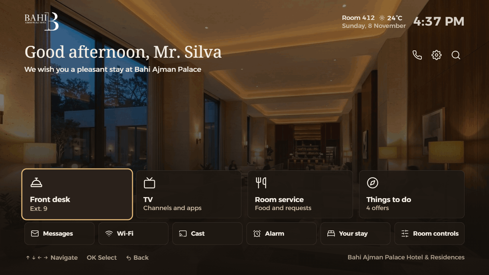

</details>

<details>
<summary><strong>Messages</strong></summary>

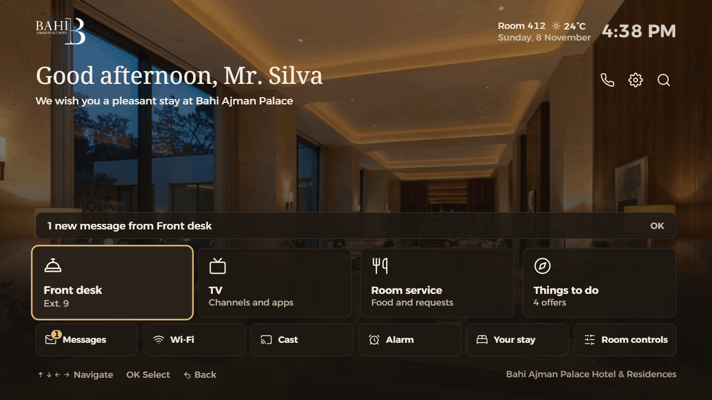

</details>

<details>
<summary><strong>Late check-out</strong></summary>

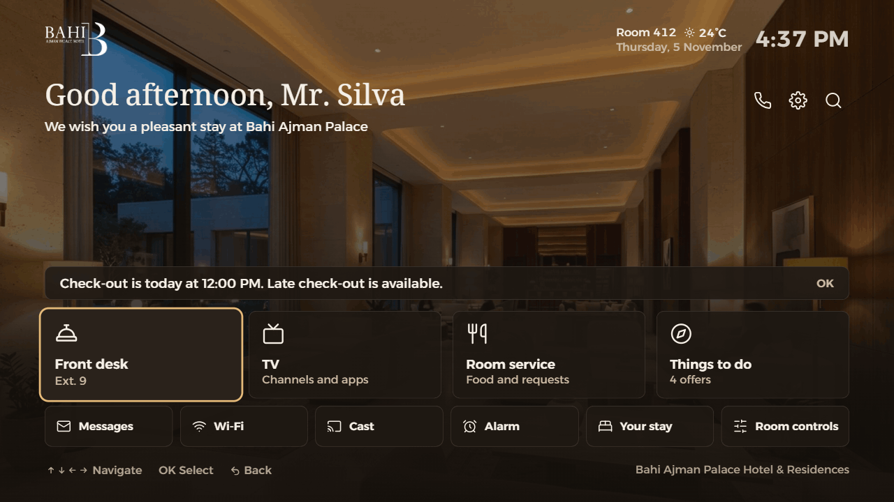

</details>

<details>
<summary><strong>Front desk and emergency</strong>, with a confirmation before an alert</summary>


</details>

<details>
<summary><strong>Your stay and weather</strong></summary>


</details>

<details>
<summary><strong>High contrast and larger text</strong></summary>


</details>

<details>
<summary><strong>Screen states</strong></summary>

|                                                                                             |                                                                              |
| ------------------------------------------------------------------------------------------- | ---------------------------------------------------------------------------- |
|  Morning                            | 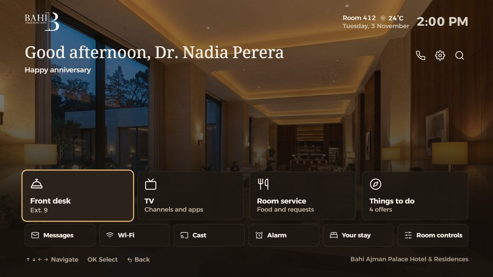 Guest occasion |
|  Unread messages             | 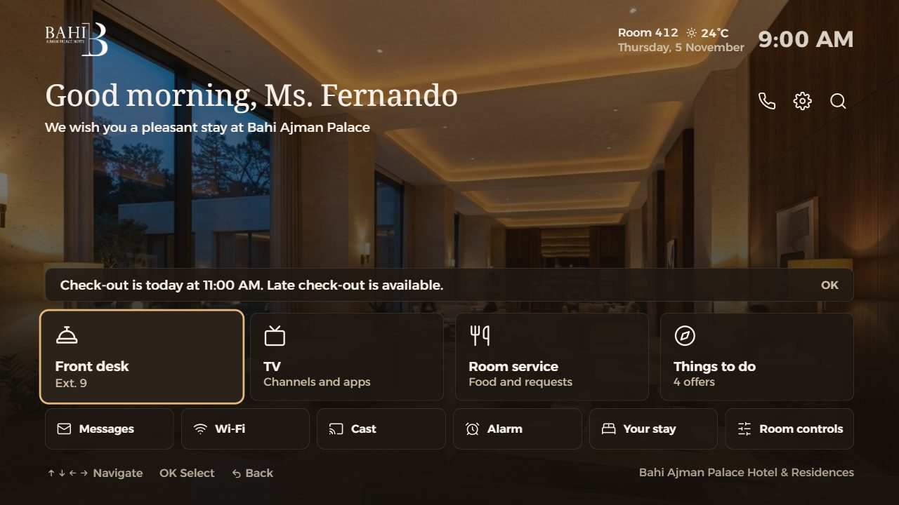 Check-out day    |
| 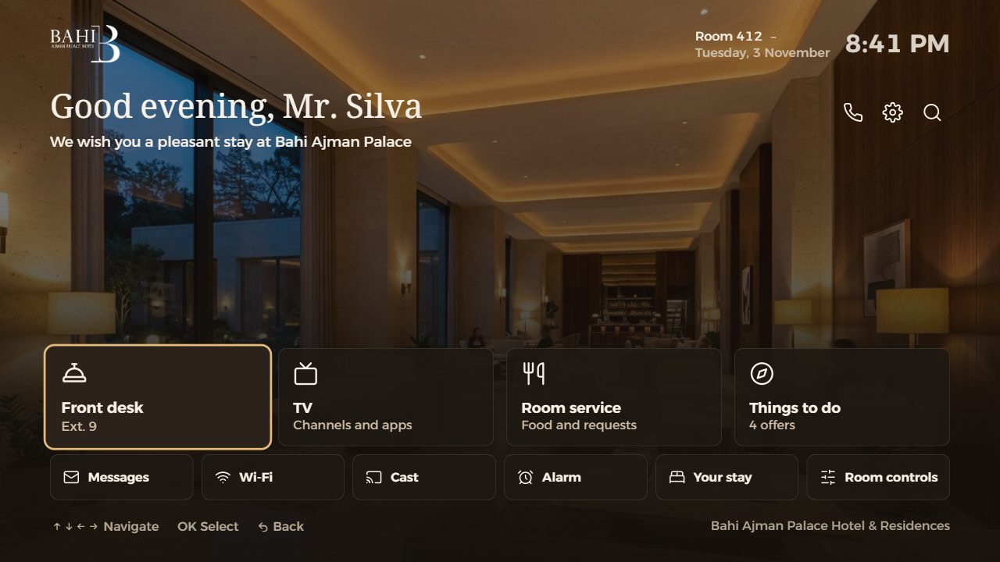 Weather unavailable | 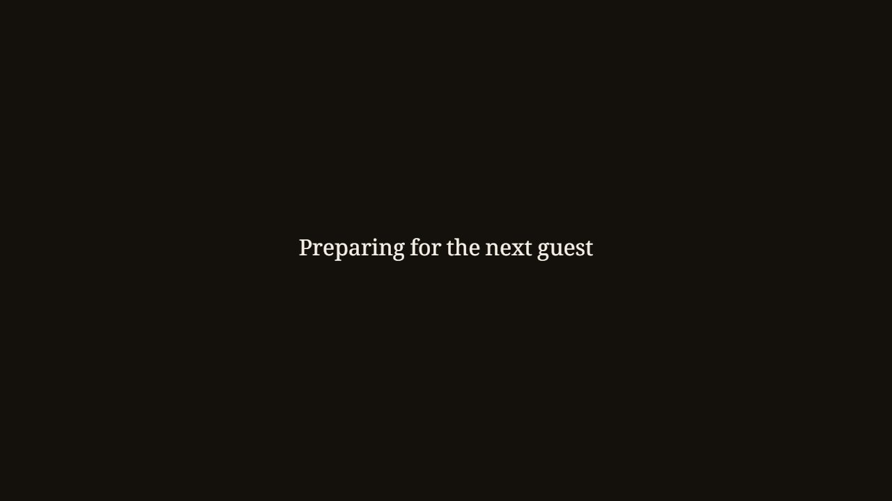 Between guests |
| 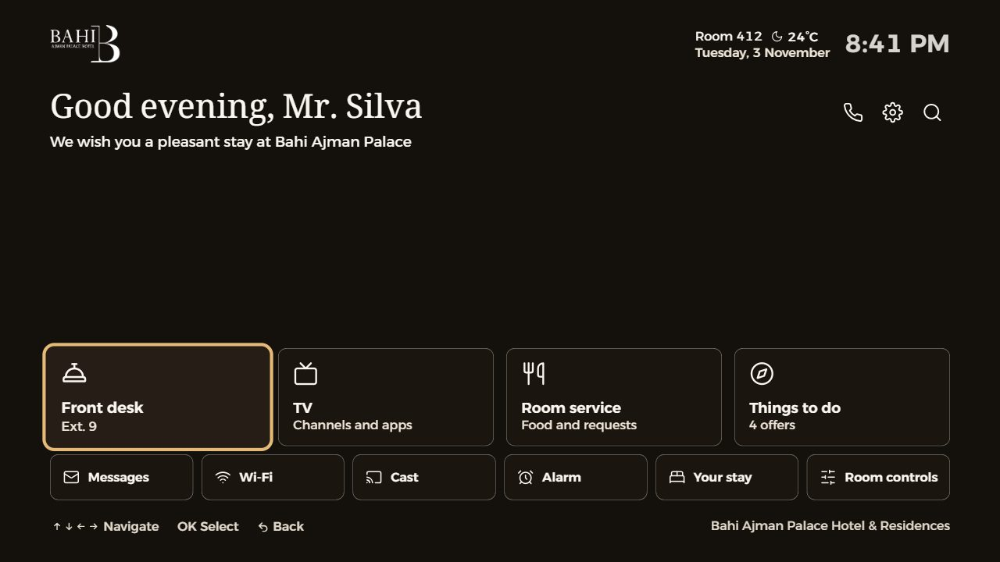 High contrast                   | 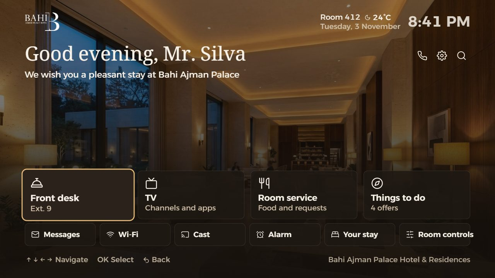 Larger text          |

</details>

## Credits

- **Fonts:** Alexandria and Noto Naskh Arabic, SIL Open Font License. Licence files are in `public/fonts/`.
- **Icons:** outline icons from an older Lucide release, ISC licence. They are copied into the project as path data.
- **Offer photos:** afternoon tea, daily activities and sunset boat trip are under the Unsplash License.
- **Heritage tour photo:** "Photo: Ajman Fort by Ahmed Fouad, CC BY-SA 3.0, via Wikimedia Commons".
- The hotel name and logo belong to Bahi Ajman Palace Hotel.
