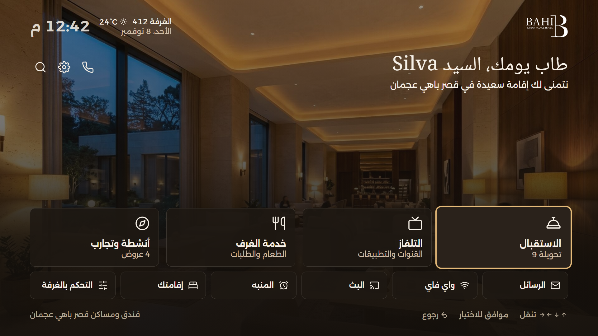

# Bahi TV

The in-room TV home screen for Bahi Ajman Palace Hotel. A guest uses a TV remote to reach the front desk, room service, the TV, offers, Wi-Fi, messages, alarms and room controls. Everything is in English and Arabic, and Arabic mirrors the whole layout.

The screen is a fixed 1920×1080 canvas, scaled to fit any window.

**Live demo:** https://hansajaweerarathna.github.io/bahi-tv-preact/?demo




## Run it

```bash
npm install
npm run dev
```

Other scripts:

```bash
npm test          # unit tests
npm run lint
npm run typecheck
npm run build     # production build in dist/
npm run preview   # serve dist/ locally
```

## Remote keys

| Keyboard            | TV remote button | Action                        |
| ------------------- | ---------------- | ----------------------------- |
| Arrow keys          | D-pad            | Move focus                    |
| Enter               | OK               | Select                        |
| Escape or Backspace | Back             | Back                          |
| H or Home           | Home             | Home screen                   |
| M                   | Menu             | Settings                      |
| + or =              | Volume up        | Volume up by 5                |
| - or \_             | Volume down      | Volume down by 5              |
| 0 to 9              | Number keys      | Tune a channel on the TV page |

Add `?demo` to the address to show the demo keys:

| Key | Action                                            |
| --- | ------------------------------------------------- |
| N   | New message on or off                             |
| C   | Check-out day on or off                           |
| P   | Offer layout                                      |
| S   | Review states (eleven states, Up, Down and Enter) |
| D   | Key legend                                        |

## Scope

The assignment asked for the home page and its navigation. The other pages (room service, offers, Wi-Fi, stay, weather, room controls, alarms, settings, search and the system screens) were built afterwards, phase by phase.

## How it is built

Preact with Preact Signals, preact-iso for routing, Tailwind CSS v4 and Vite. TypeScript is strict.

The code follows Feature-Sliced Design. Each layer may import only from the layers below it:

```
src/
  app/        startup, routes, global styles
  pages/      one folder per screen
  widgets/    large page regions (header, tiles, background)
  features/   user actions (alarms, order food, demo tools, volume)
  entities/   data and signals (guest, offers, weather, alarms)
  shared/     UI parts, remote navigation, i18n, time helpers
```

## Decisions

- **Focus moves by position on screen**, not by a fixed list of neighbours. Arabic mirrors the layout, so the remote needs no key swap, and a new page needs no navigation code.
- **One fixed canvas, scaled with a single transform**, so the layout is the same on every TV size.
- **Colours and sizes are design tokens** in Tailwind's `@theme`. High contrast and larger text change those tokens; they don't add separate styles.
- **Hotel time** (Asia/Dubai) drives the clock and the greeting, not the TV's own clock.
- **Only the home screen loads at start-up.** Other pages load the first time they are opened.
- **Alarms and guest details are kept in memory only.** Nothing is saved to the browser, as in the original.

## Why Preact

A hotel TV has a slow processor and little memory. Preact gives the same component model as React with a much smaller runtime. Signals update only what reads a value: each minute the clock changes its own text directly, and only the greeting and notice re-render.

## Bundle size

Measured with `npm run build`, gzipped:

| What loads at start-up | Size     |
| ---------------------- | -------- |
| JavaScript             | 35.32 KB |
| CSS                    | 7.10 KB  |

Measured by gzipping every file that `dist/index.html` loads, with Node's built-in zlib (default level). Every other page, and the QR library, loads the first time it is needed.

## Change it

- **Brand colour:** `--color-gold` in `src/app/styles/theme.css`.
- **Hotel name:** `hotel.name` and `hotel.footerName` in `src/shared/i18n/locales/en/a.ts` and `ar/a.ts`.
- **Switch a tile off:** set `enabled: false` in `src/widgets/service-tiles/tiles.ts`. The layout and remote navigation adjust on their own.

## Assumptions

- Guest, message, weather and offer details are sample data. There is no hotel system behind them.
- A keyboard stands in for the remote in this demo.
- The app is served from a web server that returns `index.html` for any path. A packaged Tizen or webOS app runs from `file://` and would need hash or in-memory routing.
- The target is Chromium 111 or newer, which Tailwind CSS v4 requires. Older built-in TV browsers are not supported.

## Not tested yet

- A physical TV and remote. Tizen and webOS send their own key codes for some buttons, and those still need mapping.
- Arabic rendering in a real TV browser. It has been checked in desktop Chrome only.
- Performance on TV hardware.

## With more time

- Connect guest, messages and weather to the hotel's systems.
- Test on the hotel's TV models and map their remote keys.
- Replace the sample photography with the hotel's own.

## Credits

- **Fonts:** Alexandria and Noto Naskh Arabic, SIL Open Font License. Licence files are in `public/fonts/`.
- **Offer photos:** afternoon tea, daily activities and sunset boat trip are under the Unsplash License.
- **Heritage tour photo:** "Photo: Ajman Fort by Ahmed Fouad, CC BY-SA 3.0, via Wikimedia Commons".
- The hotel name and logo belong to Bahi Ajman Palace Hotel. They are used here for this design exercise.
